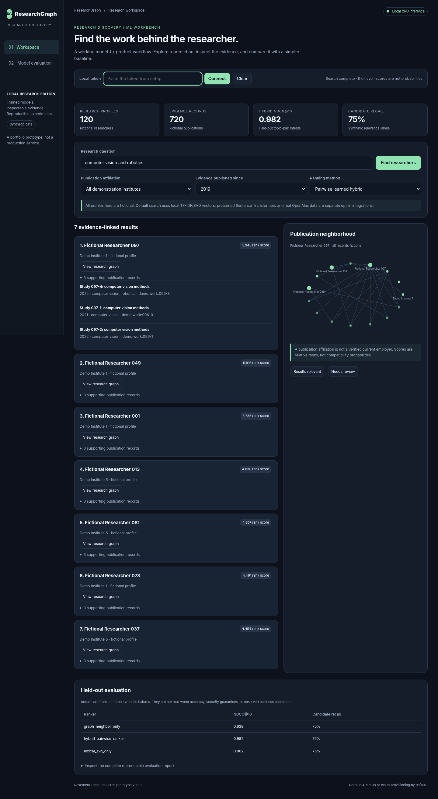

# ResearchGraph
 ### Evidence-Linked Researcher Discovery

 Search for research expertise, rank candidate researchers, inspect the publications supporting a match, and browse a small research graph.

 

 **Status:** runnable, local research prototype with included trained weights and an
 authored synthetic demonstration dataset. This is not a production system or a
 claim of real-world model accuracy. No paid API, GPU, cloud account, Node.js build,
 or external service is needed for the default application.

 ## What is implemented

 - A graph of authors, papers, topics and fixture affiliations, with evidence-linked results and relationship visualization.
- Offline TF-IDF/SVD vectors for candidate retrieval and a pairwise neural reranker combining textual and graph features.
- Topic-pair-grouped query splits, retrieval-only and graph-only comparisons, and candidate-recall reporting.
- Institution/year filtering, persisted search/relevance feedback, OpenAlex normalization and optional external-index adapters.

 **Default stack:** Python, PyTorch, scikit-learn, NetworkX, NumPy, FastAPI, SQLite, HTML/CSS/JavaScript.
 The dashboard is vanilla JavaScript served by FastAPI, not a Next.js placeholder.

 ## Quick start

 Use Python 3.11 or newer. Python 3.13.5 was used for this delivery's
 actual local validation. Start from this repository's root folder:

 ```bash
 python -m venv .venv
 ```

 macOS/Linux:

 ```bash
 source .venv/bin/activate
 ```

 Windows PowerShell:

 ```powershell
 .\.venv\Scripts\Activate.ps1
 ```

 Then, on either platform:

 ```bash
 python -m pip install -e ".[dev]"
 python -m researchgraph setup
 python -m researchgraph serve
 ```

 Open **http://127.0.0.1:8105** and paste the token printed by `setup` into
 the dashboard. The model weights are already included. The token and SQLite state
 live in `var/`, which is excluded from Git. These are single-operator demos, not
 multi-user account systems.

 ## Reproduce the experiment

 ```bash
 python -m researchgraph demo
 python -m researchgraph report
 python -m researchgraph train
 python -m pytest -q
 node --test tests/ui.test.mjs
 ```

 Training overwrites the included model artifacts and evaluation JSON. Run training
 with the server stopped; then restart it to load the new model. Training is seeded
 and CPU-friendly, but exact numerical results can vary with library versions and
 hardware. `constraints-tested.txt` records direct installed package versions;
 it is not a full cross-platform dependency lock.

 ## Workflow and API

 The UI calls authenticated `/api/` endpoints; `/health`, `/openapi.json` and static
 assets are public. Every request to data/inference APIs uses
 `Authorization: Bearer YOUR_LOCAL_TOKEN`. See [API examples](docs/API.md).
 Models are evaluated in-process. SQLite stores only local application state.

 ## Data and evidence

 120 fictional researchers, 720 fictional works and 132 query paraphrases. Topic-pair intents, rather than individual paraphrases, are split into training/validation/test (84/24/24 queries). Relevance grades are weak labels derived from fixture topic coverage; they are not judgments by domain experts. The fixed publication corpus is visible at indexing time; this is transductive retrieval, not new-author generalization.

 **Evaluation:** NDCG@10 against the synthetic relevance judgments and grade≥2 candidate Recall@40, compared with lexical/SVD-only and coauthor-graph baselines. Relative model scores are not confidence, suitability or compatibility probabilities.
 Inspect [actual results](reports/metrics.json), [validation evidence](reports/VALIDATION.md),
 the [model card](docs/MODEL_CARD.md) and [data card](docs/DATA_CARD.md).
 A more complicated model is not automatically better; baseline results are retained.

 ## Optional integrations

 `scripts/import_openalex.py` normalizes a locally saved works API response without network calls. `integrations.semantic_index` builds a separate Sentence Transformers index from a trusted local model. `VECTOR_BACKEND=faiss` enables exact FAISS retrieval for the demo. `sync_neo4j` uses parameterized, namespaced upserts. Sentence Transformers, FAISS and Neo4j runtimes were not live-tested. The synthetic-trained reranker is not automatically applied to imported real profiles.

 ## Important limits

 Default vectors are local TF-IDF/SVD, not pretrained semantic embeddings. All demonstration people and papers are fictional. This repository does not claim verified current employment, complete employment history, researcher availability, contact information or hiring suitability. It does not replace the user’s existing people-discovery startup or prescribe changes to that system.

 ## Repository guide

 ```text
 src/researchgraph/
   data.py, model.py, training.py  # data, learned model, reproducible experiment
   service.py, api.py             # inference/product logic and FastAPI routes
   common.py                     # auth, local state and artifact checksums
   static/                       # working HTML/CSS/JavaScript dashboard
   assets/artifacts/             # trained weights, fixtures, metrics, manifests
 tests/                          # model, data, API, persistence and UI checks
 docs/                           # design, safety, model/data cards, portfolio guide
 reports/                        # measured results and validation evidence
 .github/workflows/test.yml       # CI definition; not claimed remotely executed
 ```

 ## Browser validation

 ```bash
 python -m pip install -e ".[browser]"
 python -m playwright install chromium
 python scripts/browser_smoke.py
 ```

 The browser harness uses the actual repository UI and real backend through a local
 request bridge because the delivery environment blocks browser URL navigation.
 Session storage is emulated for the opaque test origin. It verifies DOM behavior,
 API requests, mobile overflow and interactions, but does not validate native ESM
 loading over HTTP, browser CSP enforcement or a production reverse proxy.

 ## Docker

 ```bash
 # Set APP_TOKEN in your shell to a long random value before starting.
 docker compose up --build
 ```

 Docker files are included but were not built or deployed in this environment.
 Read [security boundaries](docs/SECURITY.md) before exposing any service.

 ## GitHub and portfolio

 [Publishing instructions](docs/PUBLISH.md) · [Accurate résumé wording](docs/PORTFOLIO.md)
 · [Architecture](docs/ARCHITECTURE.md) · [Next experiments](docs/NEXT_STEPS.md)

 The source code and authored fixtures are MIT-licensed. Third-party libraries,
 imported datasets, model weights and external APIs retain their own terms. Nothing
 has been pushed to a GitHub account or provisioned in the cloud.
